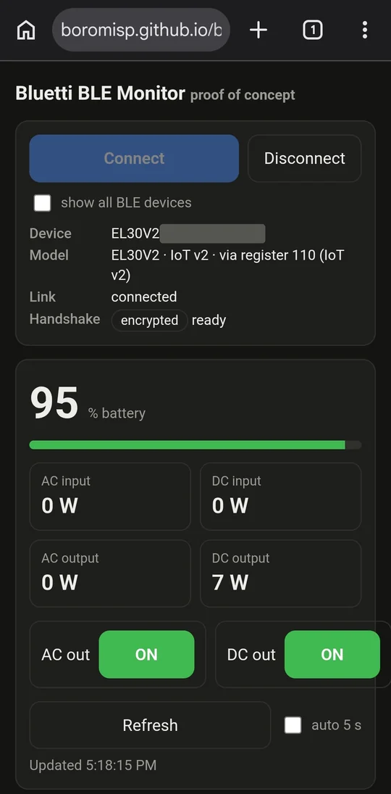
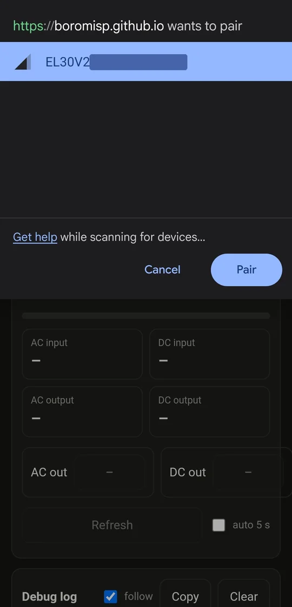

# bluetti-ble-web

A single-page web app that connects to a Bluetti power station over **Web Bluetooth** (Chrome on Android or desktop) and shows its status: battery %, AC/DC input and output power, and AC/DC output on/off. It has a refresh button, AC/DC output toggles and a scrolling debug log of every raw frame.

**Live page: https://boromisp.github.io/bluetti-ble-web/**

This is a proof of concept. Confirmed working on an **EL30V2** (encrypted handshake, status readout and AC/DC toggles).

<p>
  
  
</p>

## Usage

Open the [live page](https://boromisp.github.io/bluetti-ble-web/) in Chrome, or serve `index.html` from any other HTTPS origin. Web Bluetooth needs a secure context and doesn't work inside sandboxed iframes. `index.html` is self-contained, with no network requests at runtime.

## How it works

- **Connecting:** `requestDevice` filters on the name prefixes of the models bluetti-bt-lib supports and asks for service `0xff00`. It uses notify characteristic `ff01` and write characteristic `ff02`. Every write uses `writeValueWithResponse`.
- **Detecting encryption:** if the first notification starts with `2a2a`, the page runs the encrypted handshake ported from `encryption.py`. The handshake goes challenge → ECDSA-signed ECDH key exchange → AES-CBC with a per-message MD5-derived IV. If no notification arrives within 3 s, it uses plain Modbus.
- **Crypto:** WebCrypto handles ECDH and ECDSA on P-256. `@noble/ciphers` handles AES-CBC without padding, and `@noble/hashes` handles MD5; both are bundled inline.
- **Split responses:** Modbus frames and encrypted messages split across notifications are joined back together by their length headers.
- **Model detection:** the model comes from the device-type register (110 for IoT v2, 10 for IoT v1), with the BLE name as a fallback. Register addresses per model come from bluetti-bt-lib's `devices/*.py`. The toggles only work on models where that library defines a writable `ctrl_ac`/`ctrl_dc` register.

## Development

```sh
npm install
npm test        # builds index.html, then runs the protocol tests against a simulated device
npm run build   # rebuilds index.html from src/
```

- `src/proto.js`: protocol core, covering Modbus framing, the handshake, register maps and the session
- `src/template.html`: the UI; `build.mjs` inlines the noble bundle and `proto.js` into it
- `test/protocol.test.js`: runs a fake device built on Node's `crypto` (independent of noble and WebCrypto), in both plain and encrypted mode, with 20-byte notification fragments

## Credits

- Encryption handshake: [nhurman/bluetti_mqtt](https://github.com/nhurman/bluetti_mqtt) (`bluetti_mqtt/bluetooth/encryption.py`), MIT
- Device detection, register maps and field parsing: [Patrick762/bluetti-bt-lib](https://github.com/Patrick762/bluetti-bt-lib), MIT

The signing keys and the static AES key in `src/proto.js` are the public constants from those projects. They're extracted from Bluetti's firmware and apps, so they aren't secrets.

Not affiliated with Bluetti.
